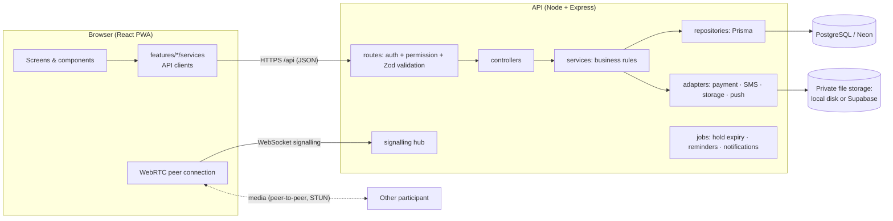
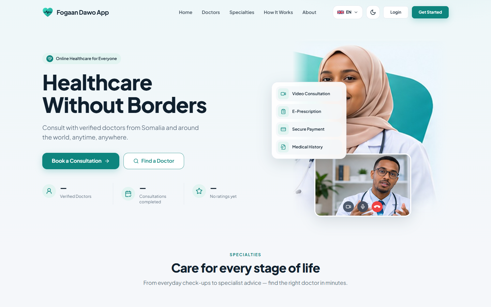
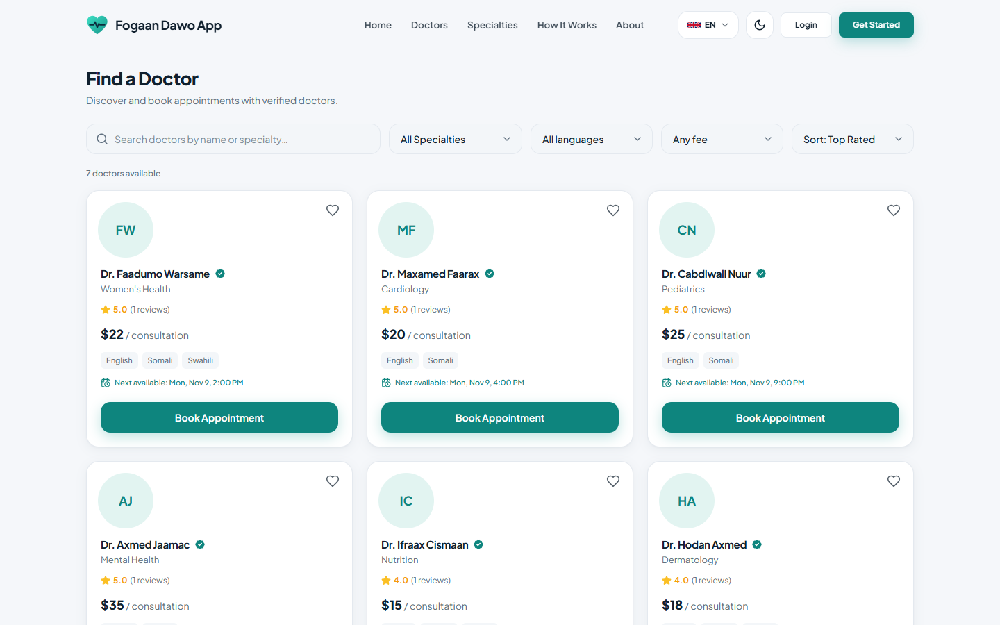
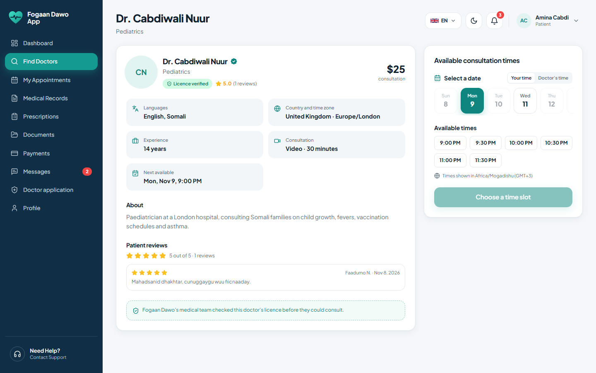
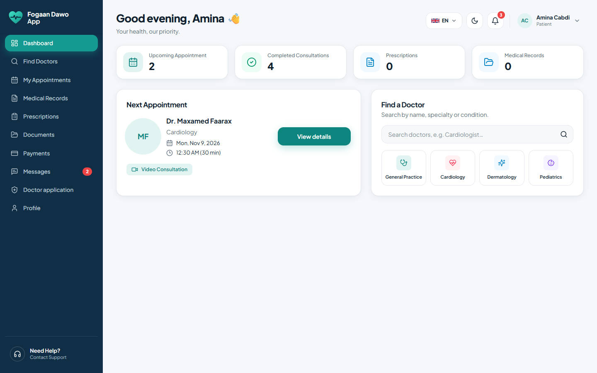
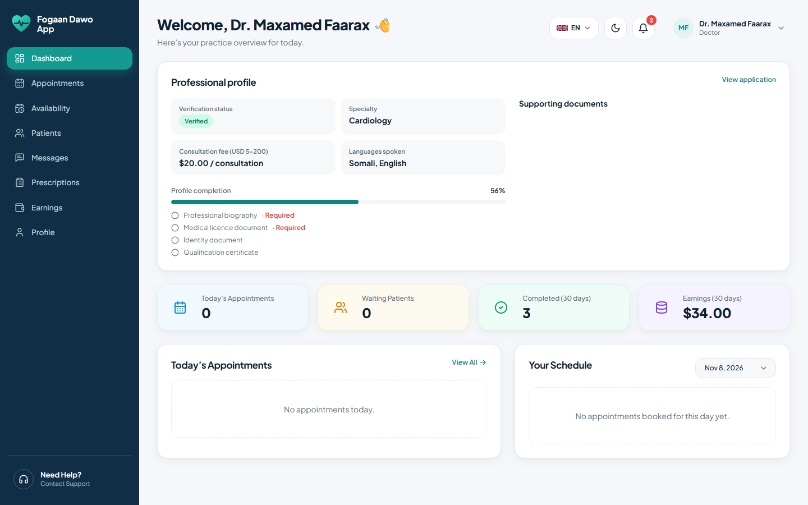
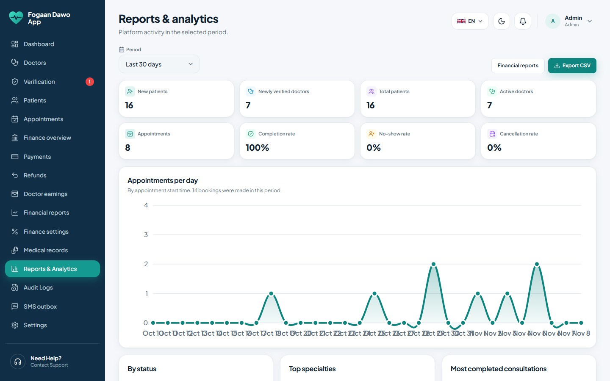
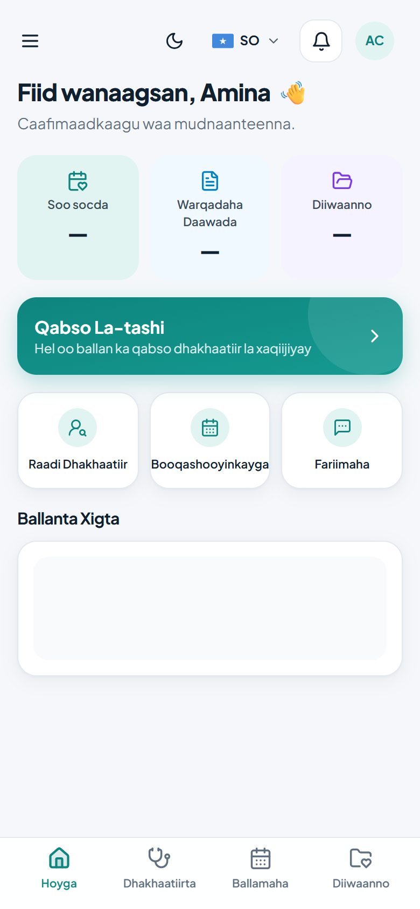
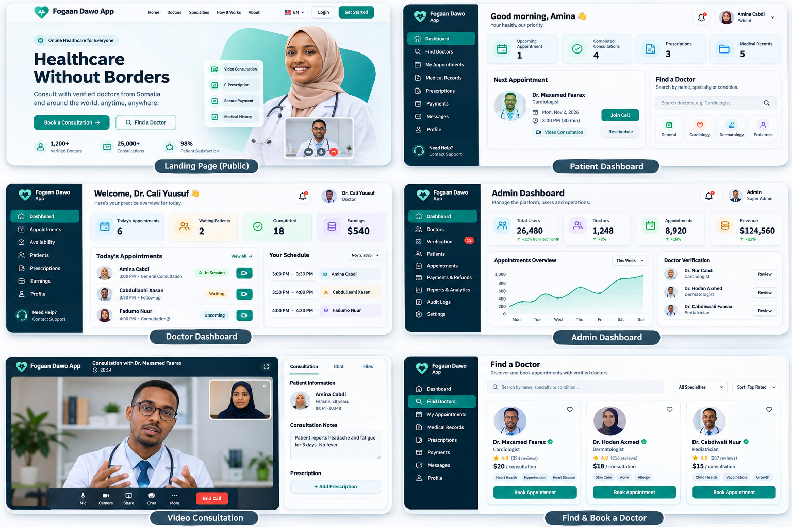

# Fogaan Dawo — Telemedicine Platform

**Healthcare Without Borders.** A bilingual (English / Somali) telemedicine platform where patients find,
book, pay for and hold video consultations with doctors, including Somali doctors in the diaspora.

## The problem

Patients outside the big cities cannot reach specialists. Many Somali specialist doctors live abroad and could
help, but there is no simple, trusted way to book, pay for and hold a consultation across time zones.
Fogaan Dawo connects them: verified doctors publish availability in their own time zone, patients see it in
theirs, pay with (simulated) mobile money and meet in an in-browser video call.

## Roles

| Role | Does |
|---|---|
| **Patient** | Finds doctors, books and pays, attaches lab results, joins the waiting room and the call, chats and shares files, reads advice and prescriptions, rates the consultation |
| **Doctor** | Applies with a licence, sets weekly availability in their own zone, admits patients, holds the call, writes notes and e-prescriptions, books follow-ups, sees earnings per month |
| **Admin** | Verifies or rejects doctors, edits and suspends doctors, manages specialties and booking rules, processes refunds, sees reports, audit logs and the SMS outbox |

## Features

Status: **Done** = working end to end and tested; **Partial** = works with the limitation stated.

### Core technical challenge

| "Done when" condition | Status |
|---|---|
| Two devices on the same network hold a video call with mute and camera controls (WebRTC through our own WebSocket signalling server) | **Done** |
| A slot set by a doctor in one time zone appears at the correct local time for a patient in another (slots stored in UTC, shown with the zone name) | **Done** |
| A call cannot be joined outside its window: 10 minutes before to 30 minutes after the start | **Done** (enforced on the server; an already running call may reconnect after that) |

### Required features

| # | Feature | Status | Notes |
|---|---|---|---|
| 1 | Doctor profiles | **Done** | Name, photo, specialty from the admin-managed list, languages, country and time zone, experience, licence number and country, fee ($5–$200), bio. Admins can edit (Admin › Doctors › Edit). A fee change affects new bookings only. |
| 2 | Doctor verification | **Done** | Licence upload (PDF/image), admin Verify / Reject with reason, "Verified" badge, suspension cancels and refunds future bookings automatically. |
| 3 | Availability | **Done** | Weekly repeating periods in the doctor's zone, 20- or 30-minute slots, blocked dates; booked slots are never deleted. |
| 4 | Search | **Done** | Filter by specialty, language and maximum fee; sort by next available or rating; only verified, active doctors with a free slot in the next 30 days; "No doctors match; try removing a filter". |
| 5 | Booking and payment | **Done** | Reason, optional lab-result attachments, mock mobile money (EVC Plus, ZAAD, eDahab), 10-minute hold, one booking per slot (database constraint), a failed payment releases the slot immediately. |
| 6 | Waiting room | **Done** | Opens 10 minutes before; doctor sees "Patient waiting" and admits; if not admitted 15 minutes after the start the patient can request a full refund. |
| 7 | Video call | **Done** | Mute, camera on/off, end call, call timer; start/end times saved; audio-only with "Video unavailable" when video fails. |
| 8 | In-call chat and files | **Done** | Chat panel beside the video; images/PDFs up to 5 MB; saved to the consultation record; messages are stored on the server, so they reach someone who was reconnecting. |
| 9 | Consultation notes | **Done** | Complaint, assessment, diagnosis, advice; advice always visible to the patient, other sections when marked shareable; editable for 24 h then locked; a consultation cannot be completed without notes. |
| 10 | E-prescription | **Done** | Medicines (name, dose, frequency, duration); PDF with doctor details, licence, date and QR code; public verification page shows "Valid" or "Cancelled", never the diagnosis. |
| 11 | Cancel and reschedule | **Done** | Patient: >24 h 100 %, 2–24 h 50 %, <2 h none; doctor: always 100 %; one free reschedule >24 h before; refunds simulated with receipts; doctors with >3 cancellations in a month are flagged for admins. |
| 12 | Follow-up | **Done** | Doctor books a follow-up in one of their free slots with a normal, 50 % discounted or free fee; the patient confirms (and pays unless free) within 48 h or the slot is released; linked to the original consultation. |
| 13 | Ratings and earnings | **Done** | 1–5 stars and a comment, completed consultations only, once each; doctors see earnings per month (fees minus the admin-set commission); refunded consultations are excluded. |

### Common baseline

| Requirement | Status | Where |
|---|---|---|
| Layered architecture (UI → services → data access) | **Done** | `apps/web` never touches the database; `apps/api/src/modules/*/` routes → controllers → services → repositories. See [Architecture](#architecture). |
| Login with role-based access, server-side permission checks, audit log | **Done** | JWT access token + rotating refresh cookie, 3 roles, permission checked on every request, `audit_logs` (who, what, when) — Admin › Audit logs. |
| Relational database, migrations, realistic seed | **Done** | PostgreSQL (Neon), 41 tables, Prisma migrations, seed with Somali names, real cities and realistic fees. See [docs/database.md](docs/database.md). |
| Automated tests (≥ 15), CI, one command | **Done** | 300+ unit and integration tests, `npm test`, GitHub Actions. |
| Code on GitHub with documentation | **Done** | This README, [docs/api.md](docs/api.md), [docs/architecture.md](docs/architecture.md), [docs/database.md](docs/database.md). |
| Security basics | **Done** | bcrypt, Zod validation on every input, rate limiting, secrets only in `.env` (see `.env.example`). |
| Analytics dashboard with ≥ 2 charts from real queries | **Done** | Admin dashboard, Admin › Reports, Admin › Finance reports — all from SQL, no hard-coded numbers. |
| Somali and English everywhere, phone and laptop layouts | **Done** | Language switch on every screen; receipt and prescription PDFs in both languages; responsive layout and installable PWA. |
| Simulated payments and SMS behind adapters | **Done** | `apps/api/src/adapters/payment` (EVC Plus, ZAAD, eDahab with confirmation and receipt) and `apps/api/src/adapters/sms` (in-app outbox: Notifications › SMS outbox, Admin › SMS outbox). |

## Architecture



- **UI** (`apps/web`) only calls the API through small service modules; it never reads the database.
- **Routes** authenticate, check the permission for the active role and validate input with Zod.
- **Services** hold every business rule (booking holds, refund tiers, join window, note lock, follow-ups…)
  and run multi-step changes in one transaction with row locks.
- **Repositories** are the only Prisma callers. Database constraints and triggers back the critical rules
  (one booking per slot, immutable issued prescriptions, archived-only documents).
- **Adapters** isolate simulated payments, SMS, file storage and push so real providers can replace them.

Folder guide: [docs/architecture.md](docs/architecture.md). Endpoints: [docs/api.md](docs/api.md).
Tables and relations: [docs/database.md](docs/database.md).

## Tech stack

| Layer | Technology |
|---|---|
| Runtime | Node.js 22.9+ / 24 (tested on 24.14) |
| Web | React 18.3, React Router 7.18, Vite 6.4, Tailwind CSS 3.4, lucide-react 0.460 |
| API | Express 4.22, Zod 4.6, ws 8.18 (signalling), bcrypt 6.0, web-push 3.6, qrcode 1.5 |
| Database | PostgreSQL on Neon, Prisma 6.19 |
| Files | Private local disk (development) or Supabase Storage 2.118 (hosted) |
| Video | WebRTC in the browser, own WebSocket signalling server, STUN + Cloudflare TURN relay (optional) |
| Tests | `node:test` (unit + integration on isolated database schemas), GitHub Actions |

## Setup from a fresh computer

1. **Install** Node.js 22.9 or newer and Git, then:
   ```bash
   git clone https://github.com/Ahmed-Naafic/fogaan-dawo-platform.git
   cd fogaan-dawo-platform
   npm install
   cp .env.example .env
   ```
2. **Database.** Create a free PostgreSQL database (for example a Neon project). In `.env` set
   `DATABASE_URL` (pooled connection), `DIRECT_URL` (direct connection) and `DATABASE_ENV=development`.
   Set `JWT_ACCESS_SECRET` to 32+ random characters and `SEED_DEV_PASSWORD` to a password of 12+ characters
   for the demo accounts.
3. **Create the tables and load the seed data:**
   ```bash
   npm run db:migrate:deploy
   npm run db:seed
   ```
4. **Run:**
   ```bash
   npm run dev          # web on http://localhost:5173, API on the PORT in .env (default 4000)
   ```
   To use a phone on the same Wi-Fi, run `npm run build` and `npm run preview -w @fogaan-dawo/web -- --host`,
   then open `http://<your-computer-ip>:4173` on the phone. Installing the app (PWA) and camera access need
   HTTPS or `localhost`.

## Running the tests

```bash
npm test               # everything (unit + integration), one command
npm run test:unit      # fast, no database needed
```

Integration tests create an isolated, throw-away schema per run in the database named by `.env.development`
(they never touch the main schema) and are skipped when no database is configured. CI runs the schema
checks, the i18n check, the tests and the build on every push and pull request.

## Demo accounts

After `npm run db:seed`, every account below uses the password you put in `SEED_DEV_PASSWORD`.

| Role | Email | Notes |
|---|---|---|
| Admin | `admin@fogaandawo.test` | Full admin console |
| Patient | `amina.cabdi@fogaandawo.test` | Mogadishu; past consultations, reviews, an upcoming booking |
| Patient | `cabdullaahi.xasan@fogaandawo.test` | Hargeisa |
| Doctor | `dr.maxamed.faarax@fogaandawo.test` | Cardiology, Mogadishu (Africa/Mogadishu) |
| Doctor | `dr.cabdiwali.nuur@fogaandawo.test` | Pediatrics, **London** (Europe/London) — shows the time-zone conversion |
| Doctor | `dr.axmed.jaamac@fogaandawo.test` | Mental Health, Toronto (America/Toronto) |
| Doctor + patient | `dr.cali.yuusuf@fogaandawo.test` | General Practice, Minneapolis (America/Chicago); has both roles |
| Pending doctor | `dr.yuusuf.xirsi@fogaandawo.test` | Application waiting for verification (demo step "verify a doctor") |

More seeded patients: Faadumo Nuur (Kismaayo), Maryan Jaamac (Baydhabo), Xasan Maxamed (Boosaaso),
Sahra Cali (Garowe), Bashiir Aadan (Beledweyne). More doctors: Dr. Hodan Axmed (Hargeisa), Dr. Faadumo
Warsame (Nairobi), Dr. Ifraax Cismaan (Dubai).

Simulated wallet numbers on the payment screen: any Somali number succeeds; numbers ending in `0001` fail,
`0002` stay pending and `0003` are approved after a status check.

## Screenshots

| | |
|---|---|
|  |  |
|  |  |
|  |  |
|  |  |

## Assumptions

Decisions made where the brief left room (recorded here as the brief asks):

- **Join window.** 10 minutes before to 30 minutes after the start, the same for 20- and 30-minute slots.
  A call that is already in progress may reconnect after that (it is continuing, not being joined).
- **Doctor no-show refund.** Available from 15 minutes after the start if the doctor has not admitted the
  patient; it cancels the appointment, withdraws the slot and requests a 100 % refund.
- **Failed payment.** The slot is released at once and the reservation ends; the patient books again.
  A payment that is still pending keeps the hold until it resolves or the 10 minutes run out.
- **Notes before completion.** At least one of complaint, assessment, diagnosis or advice must have text;
  the "End call" button tells the doctor and opens the notes panel otherwise.
- **Follow-up fees.** "Discounted" means 50 % of the doctor's current fee. A free follow-up is confirmed
  without any payment; paid ones go through the normal mock payment.
- **Doctor cancellation flag.** Counted per calendar month in UTC from doctor-initiated cancellations;
  admins are notified once when the count first exceeds 3 and see a red badge in Admin › Doctors.
- **Ratings.** Public reviews show the patient's first name and last initial only.
- **Search horizon.** "Next 30 days" is counted from now; doctors without a free slot are hidden from search
  but their profile page stays reachable by link.
- **Attachments while booking.** The patient may attach files once the slot is reserved; the doctor can see
  them only after the booking is paid.
- **SMS.** Sent for confirmations, cancellations, refunds, reminders, follow-ups, admission and new
  prescriptions; written to the in-app outbox (no SMS gateway). A user without a phone number still gets
  the outbox entry, marked "in-app only".
- **Receipts and money.** Amounts in USD; commission is set by the admin (default 15 %); all payments,
  refunds and receipts are simulated and labelled as such.
- **Time zones.** The doctor's zone is the zone of their weekly schedule; patients see times in their
  browser's zone with the zone name shown.

## Known limitations

- **Video across networks.** Calls use STUN and, when `CLOUDFLARE_TURN_KEY_ID` / `CLOUDFLARE_TURN_API_TOKEN` are set,
  Cloudflare's TURN relay with short-lived per-call credentials, so devices on different networks (mobile data,
  strict routers) can connect. Without those settings only devices that can reach each other directly connect.
- **Hosting video.** The signalling server keeps call state in memory, so video consultations need one
  long-running API instance (local or a VM). On Vercel the rest of the API works but video is disabled.
- **Background jobs on serverless hosting.** Reminders, hold expiry and push delivery run every minute in the
  local server; on Vercel Hobby they need an external scheduler calling `/api/internal/jobs/tick`.
- **Payments and SMS are simulated** by design (no real money, no SMS gateway).
- **Somali wording** has not yet been reviewed by a native medical translator.
- **Design images** in `apps/web/src/assets/images/` are cropped from the design references.
