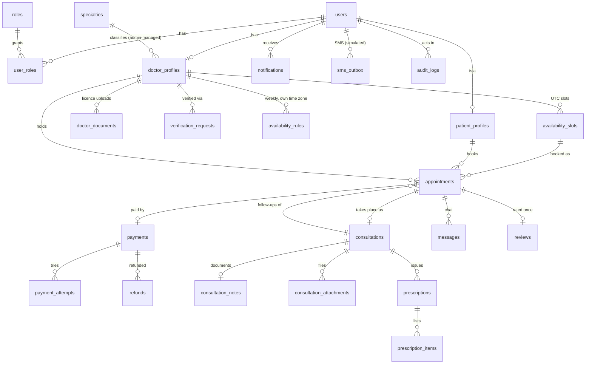

# Database

| | |
|---|---|
| Engine | PostgreSQL on **Neon**, on the project's existing **production branch** (the only branch; decision 2026-11-03) |
| ORM | Prisma **6.19.3**, JavaScript client (`@prisma/client`) |
| Schema | `prisma/schema.prisma`: 41 models and 30 enums |
| Migrations | `prisma/migrations/`: `…_init` (generated by Prisma), `…_custom_constraints` (hand-written SQL), `20261106120000_user_identities` (Google sign-in; applied to production) and `20261107090000_notifications_push_reminders` (Phase 6; additive; **not yet applied to production**) |
| Seed | `prisma/seed.js` (idempotent, development only) |
| Approved design | `docs/database/approved/` (the reviewed draft schema and constraint SQL, kept unchanged) |

## Conventions

- **Keys:** UUID primary keys (`@db.Uuid`). Join tables use composite keys (`user_roles`, `doctor_languages`).
- **Names:** tables and columns are `snake_case` (`@@map` / `@map`), so hand-written SQL can use natural names.
- **Money:** `DECIMAL(10,2)`; the commission rate snapshot is `DECIMAL(5,4)`. Application code uses `Prisma.Decimal`, never JS numbers (`apps/api/src/utils/money.js`).
- **Times:** stored as `timestamptz` (UTC). Local wall-clock times only appear in availability rules (`time`), together with an IANA time zone.
- **History is preserved.** Every foreign key is `ON DELETE RESTRICT`, so financial and medical records can't disappear through cascades. The one exception is `audit_logs.actor_user_id`, which is `SET NULL` as approved.
- **Files:** only private object-storage keys are stored, never file contents.

## Database diagram (core tables)



The minimum data model in the brief maps to: doctors → `doctor_profiles`, patients → `patient_profiles`,
specialties, availability_slots, appointments, payments, consultations, messages, prescriptions,
ratings → `reviews`, users and roles (+ `user_roles`).

## Relationship summary

```
User ─┬─< UserRole >── Role                  (one user, many roles)
      ├── PatientProfile ─┬─< PatientAddress
      │                   ├── MedicalHistory ─< MedicalHistoryEntry >─ author/editor User, optional Consultation
      │                   ├─< Appointment, Consultation, Payment, Prescription, Review
      ├── DoctorProfile ──┬── Specialty (exactly one)
      │                   ├─< DoctorLanguage, DoctorDocument (versions linked by replaces_document_id)
      │                   ├─< VerificationRequest ─< VerificationReview >── reviewer User
      │                   ├─< AvailabilityRule ─< AvailabilitySlot ─< Appointment
      │                   ├─< BlockedDate, DoctorEarning, Review, Prescription, Consultation
      ├─< Session, PasswordResetToken, Notification, AuditLog (actor)
Appointment ─┬── original Appointment (rescheduling chain) / follow-up of Consultation
             ├─< AppointmentStatusHistory >── changed-by User
             ├── Payment ─┬─< PaymentAttempt
             │            ├─< Refund ─< FinancialTransaction
             │            └─< FinancialTransaction (ledger)
             ├── DoctorEarning, Review
             └── Consultation ─┬─< ConsultationEvent, Message (sender User), ConsultationAttachment (uploader User)
                               ├── ConsultationNote
                               └─< Prescription ─< PrescriptionItem
SmsOutbox (optional recipient User), PlatformSetting (updated-by User).
```

## Where each business rule is enforced

| Rule | Database | Service (`apps/api/src/modules`) |
|---|---|---|
| One user, many roles | `user_roles` composite PK | — |
| Verification is required before search or publishing | — | `doctors/doctor.service.js`: `searchDoctors`, `publishSlots`, `reserveSlot`; `doctors/doctorDirectory.service.js` (public directory); `availability/availability.service.js` (every change) — all require VERIFIED + ACTIVE |
| Weekly hours in the doctor's zone; every instant in UTC | `availability_rules.time_zone` + `TIME` columns; `timestamptz` everywhere else | `utils/timezone.js`, `availability/availability.slots.js` (DST gaps skipped, ambiguous times → earlier instant) |
| No overlapping or duplicate slots; booked slots never replaced | exclusion constraint `availability_slots_no_overlap` | `syncDoctorSlots` reconciles under a `doctor_profiles` row lock; only future, unbooked AVAILABLE slots are replaced |
| Blocked dates/periods suppress slots | `blocked_dates` (`start_at < end_at`) | `planSlots` skips any slot overlapping a block |
| Availability history kept | `availability_rules.is_active` / `effective_until` | removed periods are deactivated, never deleted (slots keep `source_rule_id`) |
| Suspension cancels future appointments and requests full refunds | — | `suspendDoctor` (one transaction, rows locked) |
| 10-minute payment hold | `holdExpiresAt` + `(status, hold_expires_at)` index | `appointments/appointment.service.js`: `reserveSlot`, `expireStaleHolds`; payment is refused after the deadline |
| 48-hour follow-up deadline | same column | `reserveSlot` with `bookingType: 'FOLLOW_UP'` (requires a completed consultation between the same patient and doctor) |
| Only one active booking per slot | partial unique index `appointments_one_active_per_slot` | slot row locked during reservation |
| No overlapping slots | exclusion constraint `availability_slots_no_overlap` (`btree_gist`) | — |
| Rescheduling preserves the original | `original_appointment_id` self-relation, `RESCHEDULED` status | Reschedule flow: Phase 2 |
| One specialty per doctor | required `specialty_id` | — |
| Medical history separate from consultations; patient edits; doctor authorship kept | author/editor FKs use `RESTRICT` | `medical-history/medicalHistory.service.js` (authorship fields can't be changed) |
| Document versions preserved | `doctor_documents_one_current_version` partial index; `(doctor_id, version_number)` unique | `addDocumentVersion` |
| Licence replacement triggers strict re-verification | — | `addDocumentVersion`: a **VERIFIED** doctor replacing the medical licence goes to `PENDING` with a new `VerificationRequest`, and in the same transaction `revokeDoctorPrivileges` (`doctors/doctorPrivileges.service.js`) removes the DOCTOR role (PATIENT kept), withdraws every open unbooked slot via `syncDoctorSlots`, and audits it. Held/booked slots and appointments are untouched. Drafts and rejected applications just get a new version |
| DOCTOR only while verified | — | `decideApplication`: APPROVE grants DOCTOR (if missing); REJECT runs `revokeDoctorPrivileges` (no-op for first-time applicants). Resubmission never grants a role. Withdrawn slots are never restored — the doctor publishes new availability after approval |
| Applicants edit documents only while the application is editable | — | `addDocumentVersion({ allowedStatuses })` checks the status under the row lock |
| DOCTOR role only after approval; no self-approval | — | `doctors/doctorVerification.service.js`: `decideApplication` locks the profile, rejects `doctor.userId === reviewer`, grants the role in the same transaction |
| Verification history preserved | every submission is a new `verification_requests` row; every decision a `verification_reviews` row | rejection reasons are the review `notes` |
| Append-only financial ledger | trigger `financial_transactions_append_only`: no DELETE or TRUNCATE; POSTED rows fully immutable | `ledger/`, `payments/`, `refunds/` write only new entries |
| Refunds never exceed the payment | — | `refunds/refund.service.js` locks the payment row and counts REQUESTED, PROCESSING and SUCCEEDED refunds |
| Refund failures visible to admins | `refunds (status, created_at)` index | `failRefund` writes an audit log and notifies every ADMIN user; `listFailedRefunds` |
| Notes lock 24 h after the consultation | `consultation_notes.locked_at` | `consultations/consultation.service.js` |
| QR verification reveals no patient data | only `verification_token_hash` is stored | `prescriptions/prescription.service.js` returns status, issue date and issuing doctor only |
| CHECK rules (fee 5–200, rating 1–5, slot 20/30 min, ≤ 5 MB attachments, time order, login identifier) | custom migration | — |

Ledger conventions: amounts are stored as positive values, and the entry `type` says what the amount means. For each payment, `PAYMENT = PLATFORM_COMMISSION + DOCTOR_EARNING`. `reference` is unique and deterministic (`payment:<id>`, `refund:<id>`, …), so each business event is recorded once. `verifyPaymentLedger(paymentId)` checks all of this.

Transactions: booking, payment, refund, suspension and ledger writes run inside `withTransaction` (`utils/transaction.js`) and lock their rows with `SELECT … FOR UPDATE`. Expiry uses `FOR UPDATE SKIP LOCKED`, so concurrent workers are safe.

## Changes from the review draft

All of these are Prisma-required corrections or approved decisions. No business rule changed.

1. **Enum syntax:** the 27 one-line enums were expanded to one value per line. Prisma rejects the one-line form.
2. **Slot → appointments is one-to-many.** The draft's one-to-one shape requires `slot_id` to be unique, which contradicts the approved rule that cancelled and rescheduled appointments stay linked to their slot. The partial unique index enforces one active appointment per slot.
3. **Missing back-relation:** `PatientProfile.consultations` was added, which Prisma requires. `PatientProfile.payments` was added for the payment foreign key.
4. **Column names:** every column is mapped to `snake_case` so the approved constraint SQL applies as written.
5. **Payment (approved decision):** `patientId` is now the foreign key to `PatientProfile`; the duplicate `patientProfileId` field was removed.
6. **Foreign keys added** for user-ID columns that had none: verification reviewer, message sender, attachment uploader, history-entry editor, status-history `changed_by`, and setting `updated_by`. All use `RESTRICT`.
7. **History authorship:** `onDelete` changed from `SetNull` to `Restrict`, so a doctor's authorship can't be erased.
8. **Ledger immutability (approved decision):** POSTED rows are fully immutable. `REVERSED` only applies to entries that never posted, and reversals are recorded as compensating entries.
9. **Neon connections:** `directUrl` was added. Migrations use the direct connection; the app uses the pooled one.

## Environment and safety

Copy `.env.example` to `.env` and paste the Neon connection strings (Neon console → Branches → your branch → Connect):

- `DATABASE_URL`: the pooled connection (`-pooler` host). The app uses it at runtime.
- `DIRECT_URL`: the direct connection, used for migrations and tests.
- `DATABASE_ENV`: `development` or `production`, saying which database the URLs point at. It is required. Every `db:*` command runs `scripts/db-guard.mjs` first:
  - **development:** allowed. The guard refuses if a host or database name contains "prod".
  - **production** (the current setting):
    - `db:status`, `db:migrate:deploy` and `db:studio` refuse unless that single command is run as `ALLOW_PRODUCTION_DB=true npm run …`. Never put this variable in `.env`.
    - `db:seed` always refuses, because it creates development test accounts.
    - The database tests also run only with `ALLOW_PRODUCTION_DB=true`, and they stay in their own temporary schemas.

**Current state of the production branch.** The two migrations were applied while it was believed to be a development branch. They only created objects. The development seed is present and was kept by decision:
- the 3 roles and 8 specialties;
- 4 test accounts on `*.fogaandawo.test` (one admin, two doctors, one patient);
- `commission_rate = 0.15`, a placeholder.

Review the test accounts and the commission rate before going live.

**`20261107090000_notifications_push_reminders` (Phase 6) has not been applied to the production branch.** Additive only: `notifications.event_key` (unique per user) and `dispatch_pending` (default false, so existing rows are never pushed), plus the new `push_subscriptions`, `notification_preferences` and `appointment_reminders` tables and the `ReminderKind` / `ReminderStatus` enums. The API code of this phase needs it.

**`20261106120000_user_identities` (Google sign-in) was applied to production on 2026-11-06 with approval.** Additive only: a new `IdentityProvider` enum, a new `user_identities` table (unique `(provider, provider_subject)` and `(user_id, provider)`, index on `user_id`, `ON DELETE CASCADE` from `users`, non-empty subject check) and `users.password_hash` becoming nullable. No existing row is changed.

`.env` is git-ignored. Credentials are never printed: the guard only shows a masked host.

## Commands

| Command | Does |
|---|---|
| `npm run db:validate` / `db:format` | Validate or format the schema |
| `npm run db:generate` | Generate the Prisma Client |
| `npm run db:status` | Show which migrations are applied. Guarded; production needs `ALLOW_PRODUCTION_DB=true` |
| `npm run db:migrate:deploy` | Apply pending migrations. Guarded; production needs `ALLOW_PRODUCTION_DB=true` |
| `npm run db:seed` | Seed roles, specialties, the commission setting and dev accounts. Guarded, idempotent, **development only** |
| `npm run slots:sync` | Daily job: publish the next 28 days of slots for verified doctors, withdraw unbooked slots of non-bookable doctors. Guarded; production needs `ALLOW_PRODUCTION_DB=true`. Writes data — run it only when you intend to publish slots |
| `npm run test:db` | Database integration tests in isolated schemas. On production, run as `ALLOW_PRODUCTION_DB=true npm run test:db` |

## Migration process

1. Edit `prisma/schema.prisma`.
2. Create the migration SQL without touching any database:
   `npx prisma migrate diff --from-migrations prisma/migrations --to-schema-datamodel prisma/schema.prisma --shadow-database-url "$SHADOW_URL" --script > prisma/migrations/<timestamp>_<name>/migration.sql`.
   A separate Neon branch works well as the shadow database. Put hand-written SQL (constraints, triggers) in its own migration folder.
3. **Review the SQL.** Anything that drops or rewrites data needs explicit approval first.
4. Run `npm run db:migrate:deploy` against the development branch, then `npm run db:generate`.
5. Run `npm run test:db`. Commit the schema and the migration folder together.

## Seed data (development)

- Roles: PATIENT, DOCTOR, ADMIN.
- Eight specialties, in English and Somali.
- `commission_rate`: **0.15, a development placeholder**. The real rate is a business decision to confirm before launch.
- Accounts on the reserved `.test` domain:
  - `admin@…`
  - `amina.cabdi@…` (patient)
  - `dr.cali.yuusuf@…` (doctor **and** patient, to demonstrate multiple roles)
  - `dr.maxamed.faarax@…` (doctor)

  Both doctors are pre-verified. The password comes from `SEED_DEV_PASSWORD`; if it isn't set, the accounts get a random, unusable password.
- **Demo data** (`prisma/seed-demo.js`, skip with `SEED_DEMO=false`): five more verified doctors in
  Hargeisa, London, Nairobi, Toronto and Dubai (each with weekly availability in their own time zone, created
  through the availability service so slots are stored in UTC), one doctor whose application is pending,
  six patients in Somali cities with +252 numbers, six completed consultations with payments (ledger,
  commission, earnings), notes, reviews and a chat message, two upcoming paid bookings and one cancellation
  with a 100 % refund request. Idempotent: running the seed again changes nothing.

## Database tests

`tests/integration/db/*.test.js` and `npm run test:e2e` run inside a **per-run schema** (`fd_test_<time>_<random>`) on the configured branch. On production they need `ALLOW_PRODUCTION_DB=true`:

1. It applies the real migrations into that schema.
2. It runs the tests.
3. It drops **only** that schema afterwards.

The real data in `public` is never touched. Without `DIRECT_URL` (for example in CI), or on production without the opt-in, the suite is skipped and reports why.
